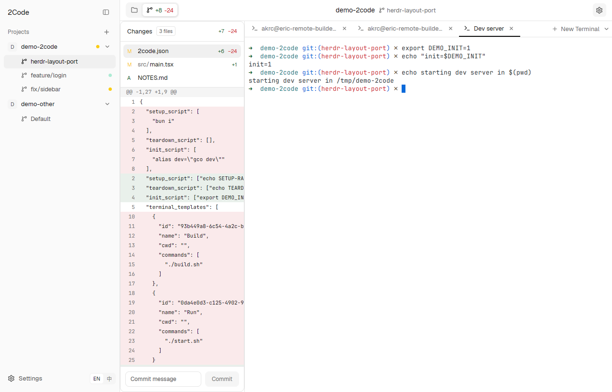

# 2code

2code's workstation, as a layout for [Herdr](https://herdr.dev).

Projects on the left with their worktree profiles nested under them, a top bar
with the project, branch and a Files / Git switch, and line-style terminal tabs
with project and global terminal templates. Herdr runs the terminals and
agents; 2code is the look and the workflow on top.



> The original Tauri desktop app lives on the
> [`legacy-tauri-app`](https://github.com/AkaraChen/2code/tree/legacy-tauri-app)
> branch and is no longer developed.

## Install

Install [Herdr](https://herdr.dev/download/), then ask the agent in any Herdr
terminal:

```
Add the layout at github.com/AkaraChen/2code
```

Or copy it yourself from a clone of this repo:

```sh
./scripts/install.sh                         # copies into ~/.config/herdr-app and runs herdr-app check
herdr-app do layout.switch --name 2code
```

`ctrl-shift-l` cycles layouts, so Herdr's own stays one key away.

## What it adds to Herdr

- **Projects and profiles.** Every Herdr space is grouped by its git repo: the
  main checkout is the default profile, worktrees are profiles under it. Nothing
  is stored: the list comes from Herdr's spaces and git.
- **New profile** (`+` on a project) opens Herdr's own New worktree dialog and
  runs the project's `setup_script` as the new space's first tab.
- **Delete profile** (`×` on a profile) runs the project's `teardown_script`
  in the worktree, then hands over to Herdr's Remove worktree, which checks for
  uncommitted work.
- **Terminal templates** from the project's `2code.json` and from
  `~/2code/2code.json`: the menu beside **New Terminal** opens a tab named
  after the template and types its commands into your shell.
- **English and 简体中文**, following the system language, `~/2code/2code.json`,
  or the EN / 中 switch in the sidebar.
- 2code's light and dark themes (`2code-light`, `2code-dark`).

Everything else (terminals that survive restarts, agent status, Files and
Changes panels, settings, remote machines) is Herdr's.

## `2code.json`

Put it at the root of a project (its main checkout; worktrees use it too):

```json
{
  "setup_script": ["bun install"],
  "teardown_script": ["rm -rf node_modules"],
  "init_script": ["nvm use"],
  "terminal_templates": [
    { "name": "Dev server", "cwd": "apps/web", "commands": ["bun dev"] }
  ]
}
```

- `setup_script` / `teardown_script`: one shell line each, run in order with
  `sh -c` in the worktree, stopping at the first failure.
- `init_script`: typed into every terminal 2code opens (New Terminal and
  templates), before a template's own commands.
- `terminal_templates[].cwd`: relative to the profile's checkout; empty means
  its root.

Global templates and the language go in `~/2code/2code.json`:

```json
{
  "language": "auto",
  "terminal_templates": [
    { "name": "Git log", "commands": ["git log --oneline -20"] }
  ]
}
```

`language` is `auto` (the system's), `en` or `zh`.

## Repository

| Path | What |
|---|---|
| `layouts/2code.json` | the layout |
| `mods/2code/` | the mod: one folder, parts chosen with `props.part` |
| `themes/` | `2code-light` and `2code-dark` |
| `RECIPE.md` | the brief to rebuild the layout from scratch (Herdr's sharing format) |
| `website/` | [2code's website](https://2code.akr.moe) (Next.js) |
| `scripts/install.sh` | copy into a Herdr home and check |
