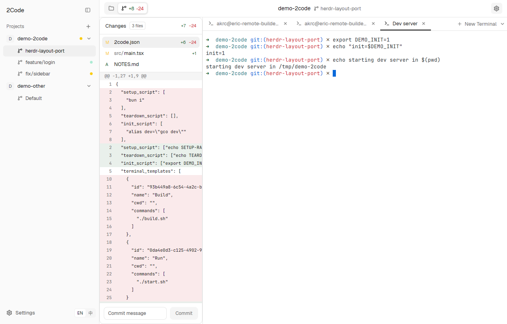

# 2code

2code's coding workstation inside Herdr: projects on the left with their git
worktree profiles nested under them, a quiet top bar with the project, branch,
pull request and a Files / Git switch, flat Files and Changes panels, a large
diff dialog with history and review comments, and line-style terminal tabs
with a terminal-template menu. Neutral grays (shadcn style), light and dark,
English or 简体中文.

## What you see

Left to right:

- **Sidebar**, 250px (min 44, max 420), `chrome` background.
  - 52px header: Herdr's mark (`frame/welcome/herdr.png`, 20px) and "Herdr"
    (15px semibold) in a 110×24 clipped slot, and a sidebar-toggle icon. Drags
    the window. On macOS (not fullscreen) it starts at 76px, clear of the
    window buttons.
  - "Projects" label (12px, `dim`) with a `+` that opens the system folder picker.
  - One 32px row per project: a 20px GitHub avatar (else a rounded letter tile),
    the name, the most urgent agent dot, a caret. Under it, one 28px row per
    profile (checkout): branch icon, branch name (main checkout first), agent
    dot. Profiles without an open space are drawn in `dim`.
  - Footer: Settings (Herdr's settings).
  - Narrower than 160px: only 24px project tiles with their dots.
- **Work column**:
  - 44px top bar (`background`, bottom border): a segmented switch (folder =
    Files, branch icon with green `+N` / red `-N` = Changes); centered, the
    project name (14px semibold; hover shows the path) and the branch; then a
    pull request chip (`#12 Open|Draft|Merged|Closed`, colored green / dim /
    `ansi5` / red), an "Open in…" button and a gear (project settings).
  - A row: a 260px side panel (stack of the `files` and `changes` parts,
    hidden until picked), then the terminal area.
    - Files: 24px rows, 12px indent, names in `muted`; new files green
      `ansi2`, modified blue `ansi4`, deleted red `ansi1`, a blue dot on
      folders with changes, a letter at the right. Click a file: read-only
      preview with a back arrow.
    - Changes: 40px header (select-all checkbox, "N changed file(s)", `+a -d`,
      expand icon), 30px rows (checkbox, name, folder in `dim` or `← old` for
      a rename, an undo icon on hover, a 16px square status badge), the picked
      file's diff, and a commit box ("COMMIT", Summary, Description, "x of y
      files included", Push N when ahead, Commit).
  - Terminal area: a 34px tab strip (2px underline on the active tab, program
    icon, title, agent dot, ×), "+ New Terminal" and a chevron for templates;
    then the active tab's panes with 1px borders, no gaps, no rounding.
- **Diff dialog** (92% × 88%): header with branch, Changes / History segments,
  "Review (N)", Unified / Split, close. Left 360px: the changes (as in the
  panel) or the commits (subject, short hash, author · age) → a commit's files.
  Right: file header (badge, path, `+a -d`), then the diff (20px rows; unified
  shows old and new numbers, split pairs removals with additions), or images
  before / after, and a comment bar when lines are selected.
- Themes `2code-light` (white, `#fafafa` chrome, `#e5e5e5` borders, GitHub
  Light terminal colors) and `2code-dark` (`#161616` terminals, `#0a0a0a`
  chrome), picked by the system appearance.

## How it behaves

- Brand: hovering the header flips the slot like a slot machine: Herdr's row
  rolls up to `top -26` and fades (260ms / 180ms, ease-in), 2code's row
  (`mods/2code/icons/2code.png`, "2Code") rises from `top 26` a beat later
  (380ms / 260ms, ease-out, 70ms delay). Leaving rolls them back the same way.
  Native `transition` on `top` and `opacity`; `spring` on `top` didn't move.
- Agent dots: `working` pulses green (`#34d399`, opacity loop 1.2s), `blocked`
  yellow (`#facc15`), `done` green (`#22c55e`), `idle` nothing. A project
  shows its most urgent profile's status.
- Projects are the shared list `2code.projects` (`[{path, machine, name?}]`).
  Every 4s the sidebar adds the repo of each open space (its main checkout:
  `git rev-parse --git-common-dir`) and reads each project's
  `git worktree list --porcelain`. Names come from the folder ("app.git" →
  "app", "bare.git" → its parent) unless renamed.
- Click a project: its shown, else first open, else main profile. Click a
  profile: select its space, or `space.new {folder}` on its checkout. Caret
  folds. Hover a project: `+` opens Herdr's `worktree` dialog (action `new`,
  folder = main checkout); if `2code.json` has `setup_script`, the new space's
  first tab ("setup" / "安装") runs it. Hover a non-main profile: `×` opens
  Delete profile.
- Right-click a project: New Profile, Rename, Project Settings, Reveal in File
  Manager (local), Remove Project (closes its spaces, drops it from the list).
  Right-click a profile: Open, Reveal, Delete Profile.
- Delete profile: shows uncommitted file count and commits on no remote, the
  teardown lines; Run teardown and delete / Skip teardown / Cancel; closes the
  space, `git worktree remove [--force]`. The branch stays.
- Project settings: tabs Scripts (setup / teardown / init, one per line),
  Project Templates (name, folder, commands) and Global Templates; Save writes
  `<main>/2code.json` and `~/2code/2code.json` keeping unknown fields, and
  never creates an empty file.
- Changes: click a row shows its diff (again hides it); checkboxes pick what
  Commit (or Enter in Summary) commits: `git add -A -- <checked>` then
  `git commit -m summary [-m description] -- <checked>`. The undo icon arms
  ("Discard?"), a second click discards (`git restore --source=HEAD
  --staged --worktree`, or `git clean -f` for new files). Push runs `git push`
  (or `-u origin HEAD` without an upstream).
- Diff dialog: clicking a line selects it; clicking another makes a range
  (shift-click too); a comment there goes into shared `2code.review[root]`.
  Review (N) lists them; Copy for Agent writes "Please address these review
  comments:" with each `file:range`, the selected diff and the comment.
- Branch (top bar): searchable list (current, trunk from `origin/HEAD`,
  "used" when another worktree has it, ↑/↓ counts, remote-only branches);
  Enter or click runs `git switch` (`--track` for remote ones).
- Tabs: click selects, right-click opens Herdr's tab menu, × closes. New
  Terminal opens a tab in the focused folder and types `init_script`. The
  chevron lists project templates and global ones; picking one opens a tab
  named after it in its `cwd` and types `init_script` then its `commands`.
- Keys (section `layout:2code`): `cmd-t`/`ctrl-shift-t` new terminal,
  `cmd-g`/`ctrl-shift-g` diff dialog, `cmd-e`/`ctrl-shift-e` panel,
  `cmd-shift-e`/`ctrl-shift-j` sidebar keyboard (↑↓ move, → open/enter,
  ← close/parent, Enter opens, Esc back to the terminal), `shift-enter`
  newline, `alt-left/right` word.
- Language: `sh -c 'printf %s "${LC_ALL:-${LC_MESSAGES:-$LANG}}"'` (PowerShell's
  `$env:` on Windows); `zh*` shows 简体中文, anything else English; shared
  `2code.locale` redraws every part.

## Built from

- Layout `layouts/2code.json`: root `row` (`titlebar: none`, traffic lights
  `[16, 24]`, theme `{light: 2code-light, dark: 2code-dark}`, JetBrains Mono
  13, terminal padding `[8, 10]`) → `sidebar` column (`brand`, `projects`
  blocks) and `work` column (`topbar` block, `work-body` row → `panel` stack
  [`files`, `changes`] and `terminal-area` column [`tabs` block, `main` tab block]).
- One mod, `mods/2code`, every block `{mod: "2code", props: {part}}`. Parts:
  `header`, `sidebar`, `topbar`, `tabs`, `files`, `changes`, and overlays
  `menu`, `templates`, `openIn` (popups), `rename`, `removeProject`,
  `deleteProfile`, `projectSettings`, `diff`, `review`, `branches` (dialogs).
  `lib/`: `i18n`, `git`, `config` (2code.json), `projects`, `changes` (git
  work), `terminal`, `os` (reveal, avatars), `ui`.
- Shipped mods used: `worktree` (New worktree), `menu` (tab menu). `files` and
  `changes` start from Herdr's shipped mods (Apache-2.0, `mods/2code/NOTICE`).
- `herdr` calls: `spaces`, `panes`, `focused`, `layout`, `theme`, `settings`,
  `shared` / `setShared`, `exec`, `hc` (`send`), `readTextFile`,
  `writeTextFile`, `watchFolder`, `pickFolder`, `openOverlay` /
  `closeOverlay`, `notify`, `nextCommand`, `appHome`, `run` (`space.*`,
  `tab.*`, `pane.focus`, `layout.*`, `app.settings`); `cx.open_url`,
  `cx.write_to_clipboard`.
- Programs: `git`, `gh`, `sh`, `curl` (avatars), `open` / `xdg-open` /
  `explorer.exe`.

## Watch out

- Herdr refuses imports from another mod's folder: everything shared lives in
  one mod, picked by `props.part`.
- `tab.new {task}` only types into agents, so templates find the new tab's
  terminal in `panes()` (`cx.sleep(100)`, up to 6s) and type each line with
  `hc send`.
- A popup's tasks end when it closes: menus draw nothing while their action
  runs and close after.
- Herdr's own Remove worktree needs an open space (without one it closes the
  focused space), so Delete profile removes the worktree itself.
- Virtual list rows can't register `on_click`: use the list's
  `on_item_click(key)`; it carries no modifiers, hence click-then-click ranges.
- Deeply nested flex leaves `size_full()` children with no height: pin the
  diff list with `absolute().inset_0()` in a `relative()` box.
- `image()` reads only the app's folder and has no fit option: images are
  copied into `mods/2code/.cache/` and sized from their headers.
- `fetch()` reads text only; avatars download with `curl`.
- No locale API (no `Intl`, no `navigator`). Herdr's own dialogs stay English.
- Plain `ctrl-` letters belong to terminal programs on Linux and Windows.

## Done when

- `herdr-app check mods/2code` passes and `layout.switch {name: "2code"}` shows
  no `herdr-app status` errors.
- Closing a project's last tab leaves it in the sidebar; clicking its profile
  opens a space there.
- Two worktrees of one repo appear as profiles under one project row.
- `+` with a `setup_script` gives a worktree whose first tab ran it; `×` runs
  `teardown_script` and removes the worktree.
- Project Settings saves templates into `2code.json` and they show in the
  template menu; picking one opens a named tab that ran its commands.
- Unchecking a file in Changes and committing leaves it uncommitted.
- Two lines clicked in the diff dialog and a comment give "Review (1)", and
  Copy for Agent puts the formatted text on the clipboard.
- `cmd-g` / `ctrl-shift-g` opens the dialog; `cmd-t` / `ctrl-shift-t` opens a
  terminal that ran `init_script`.
- With `LANG=zh_CN.UTF-8` every 2code label is Chinese; unset, English.
